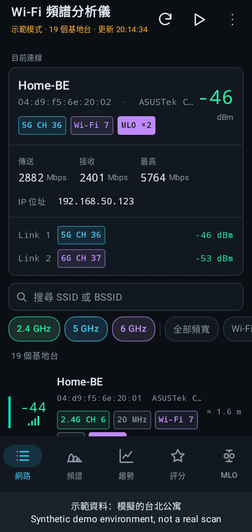
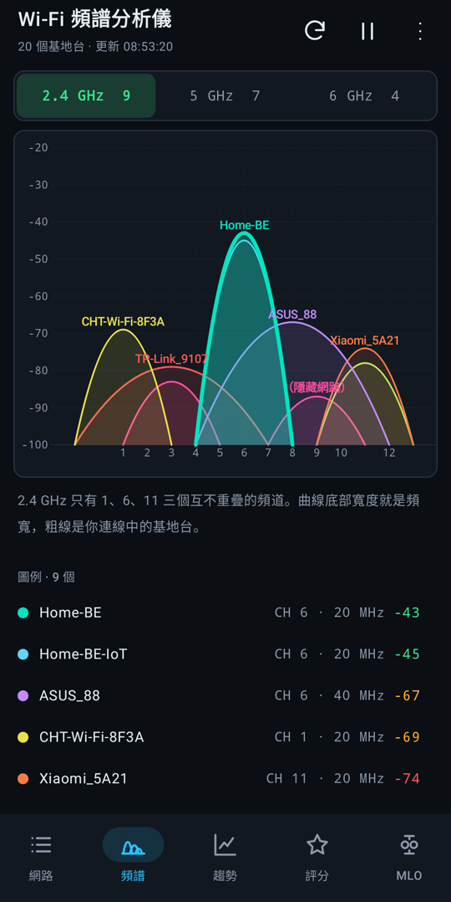
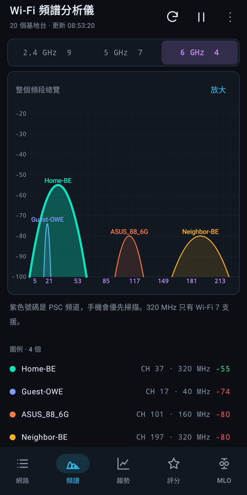
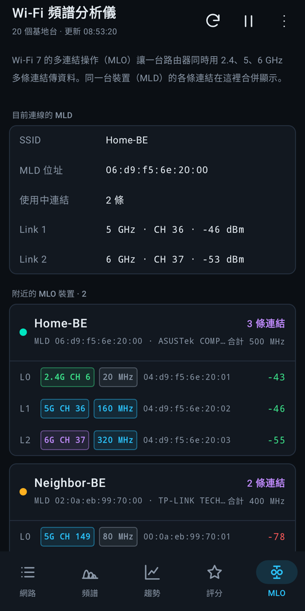

<p align="center">
  <strong>English</strong> · <a href="README.zh-CN.md">简体中文</a> · <a href="README.zh-TW.md">繁體中文</a> · <a href="README.ja.md">日本語</a> · <a href="README.ko.md">한국어</a><br>
  <a href="README.de.md">Deutsch</a> · <a href="README.es.md">Español</a> · <a href="README.fr.md">Français</a> · <a href="README.pt-BR.md">Português (Brasil)</a> · <a href="README.vi.md">Tiếng Việt</a> · <a href="README.id.md">Bahasa Indonesia</a> · <a href="README.it.md">Italiano</a>
</p>

<p align="center"></p>
<h1 align="center">Professional Wi-Fi Analyzer for Android</h1>
<p align="center">Wi-Fi Spectrum (Wi-Fi 頻譜分析儀) · 2.4 / 5 / 6 GHz · 20–320 MHz · Wi-Fi 7 MLO</p>
<p align="center">
  <a href="https://github.com/tonykfr1234/android_wifi-spectrum/actions/workflows/security.yml"></a>
  
  
  
  <a href="LICENSE"></a>
</p>
<p align="center">
  <a href="#quick-start">Quick start</a> · <a href="#workflow">Workflow</a> · <a href="#features">Features</a> · <a href="#demo">Demo</a> · <a href="#faq">FAQ</a> · <a href="#documentation">Documentation</a>
</p>

```bash
./gradlew testDebugUnitTest assembleDebug
```

---

Version 1.0: all three bands, every channel width up to 320 MHz, and Wi-Fi 7 multi-link (MLO) grouping by MLD address.

Wi-Fi Spectrum scans nearby access points on 2.4, 5 and 6 GHz and shows where each one actually transmits: its primary channel, the full 20/40/80/160/80+80/320 MHz block and every channel it covers. A spectrum view, signal trend and channel rating help you pick a quiet channel; the MLO view merges the links of each Wi-Fi 7 router.

Apple does not let iOS apps scan nearby Wi-Fi networks, so these features are Android-only. The iOS companion, [IOS_wifi-spectrum](https://github.com/tonykfr1234/ios_wifi-spectrum), covers what iOS allows.

The 12 README languages translate the documentation. The app interface currently uses Traditional Chinese.

<a id="quick-start"></a>
## Quick start

1. Download `wifi-spectrum-debug-apk` from the latest successful [GitHub Actions run](https://github.com/tonykfr1234/android_wifi-spectrum/actions), or build it with `./gradlew assembleDebug` (JDK 17+ and the Android SDK).
2. Install `app-debug.apk` on an Android 8+ phone. 6 GHz needs Wi-Fi 6E; 320 MHz and MLO need Android 13+ with Wi-Fi 7.
3. Open the app and allow **precise** location and, on Android 13+, Nearby Wi-Fi devices. Android withholds scan results without them.
4. Keep location services on. The app scans every 30 seconds while visible; tap refresh to scan now.
5. No suitable phone nearby? Choose demo mode to explore a synthetic Wi-Fi 7 environment.

**Publishing to Google Play?** Follow [docs/PUBLISHING.zh-TW.md](docs/PUBLISHING.zh-TW.md) ([English summary](docs/PUBLISHING.md)): change the application ID, create an upload key outside the project, build the signed App Bundle and complete Play Console's closed test.

<a id="workflow"></a>
## Workflow

```text
App visible, every 30 seconds (Android allows 4 foreground scans per 2 minutes)
  → WifiManager.startScan(); throttled requests reuse the cached results
  → clean each ScanResult: SSID, BSSID, band, primary channel
  → occupied block from width + centre frequency (20–320 MHz, 80+80)
  → group Wi-Fi 7 links by MLD address; look up the vendor offline
  → update list, spectrum, 60-scan trend, channel rating and MLO view
```

Scanning stops when the app leaves the screen; nothing runs in the background. When a driver omits the centre frequency, or reports a 160 MHz centre in `centerFreq1`, the block is derived from the standard channel plan. MLO fields need Android 13; the per-link signal of the connected router needs Android 14.

<a id="features"></a>
## Features

| Feature | Behavior |
| --- | --- |
| Bands | 2.4, 5 (incl. UNII-4) and 6 GHz; throttling, Wi-Fi-off and location-off notices |
| Channel width | 20, 40, 80, 160, 80+80 and 320 MHz; occupied range, centre channel and covered channels |
| Wi-Fi 7 MLO | MLD address, link IDs and affiliated links; active links and per-link RSSI of the connection |
| Spectrum | One parabola per AP; full-band overview with zoom; the connected router's links drawn bold |
| Trend | RSSI of the 10 strongest APs over 60 scans; gaps where an AP was missed |
| Channel rating | Weighted by signal and overlap; 1/6/11 only on 2.4 GHz; non-DFS preferred; PSC on 6 GHz |
| Details | Vendor from the IEEE registry, randomised-MAC detection, security incl. WPA3 SAE-EXT and OWE, distance estimate |
| Privacy | No network access, ads or analytics; scan results stay in memory |

Distance is a free-space estimate; walls make it shorter. Scan contents depend on the phone's Wi-Fi chip and driver, so check 6 GHz, 320 MHz and MLO readings with your own hardware before relying on them.

<a id="demo"></a>
## Demo

This 40-second silent walkthrough uses the **actual app UI driven by the built-in synthetic environment**: a Taipei apartment with a Wi-Fi 7 router (three MLO links) and crowded neighbours, with bilingual captions for each screen. It is not a real scan and says nothing about any particular phone's radio.



[Open or download the MP4 demonstration](docs/media/wifi-spectrum-demo.mp4)

| 2.4 GHz spectrum | 6 GHz with 320 MHz | Wi-Fi 7 MLO links |
| --- | --- | --- |
|  |  |  |

## Latest changes

First release: three-band scanning, 20–320 MHz widths, Wi-Fi 7 MLO, spectrum, trend, channel rating, Google Play assets and a publishing guide, verified by 214 offline tests on Android 8–16. See the [changelog](CHANGELOG.md).

<a id="controls"></a>
## Controls

| Control | Action |
| --- | --- |
| Refresh | Scan now |
| Pause / Play | Stop or resume automatic scanning |
| ⋮ → interval | 3, 5, 10, 30 or 60 seconds; below 30 s Android may throttle |
| ⋮ → demo mode | Switch between real scanning and synthetic data |
| Band / width / Wi-Fi 7 chips | Filter the list; tap the width chip to cycle ≥40/80/160/320 MHz |
| Zoom (5/6 GHz) | Toggle the full-band overview and a scrollable close-up |
| Tap an AP | Show its occupied range, covered channels, security and MLO links |

<a id="faq"></a>
## FAQ

**Why does it need location?** Android treats Wi-Fi scan results as location data. Without precise location (and Nearby Wi-Fi devices on Android 13+) the system returns no results. The app does not read GPS coordinates.

**Why is 6 GHz empty?** The phone needs Wi-Fi 6E support and a 6 GHz router must be in range.

**Why no MLO or 320 MHz?** They need a Wi-Fi 7 phone on Android 13 or later and a Wi-Fi 7 router with MLO enabled.

**Why does it say scanning is throttled?** Android allows four foreground scans every two minutes. Keep the 30-second interval, or disable Wi-Fi scan throttling in Developer options while testing.

**Is there an iOS version?** Apple's APIs do not expose nearby networks, so iOS cannot provide these scans. See [IOS_wifi-spectrum](https://github.com/tonykfr1234/ios_wifi-spectrum) for what iOS supports.

<a id="docs"></a>
<a id="documentation"></a>
## Documentation

| Topic | Document |
| --- | --- |
| Daily operation | [繁中使用指南](docs/USER_GUIDE.zh-TW.md) · [English User Guide](docs/USER_GUIDE.md) |
| Internals | [Architecture](docs/ARCHITECTURE.md) |
| Publishing | [Google Play guide (繁中)](docs/PUBLISHING.zh-TW.md) · [English summary](docs/PUBLISHING.md) · [Privacy policy](docs/PRIVACY.md) |
| Versions and safety | [Changelog](CHANGELOG.md) · [Security](SECURITY.md) · [Contributing](CONTRIBUTING.md) |

Code lives in `app/src/main/java`, tests in `app/src/test`, tools in `scripts/` and Google Play images in `store/`. The 214 tests run on the JVM without a phone; verify real 6 GHz, 320 MHz and MLO readings with your own hardware.

## Security

Never commit keystores, `keystore.properties`, `local.properties`, API keys or exported scans of networks you do not own. Before pushing, run the same scanner used by GitHub Actions:

```bash
python scripts/security_scan.py .
```

## License

[MIT](LICENSE).

### 2026-10-20 · 1.0.0

首次發布：2.4／5／6 GHz 掃描、20–320 MHz 頻寬、Wi-Fi 7 MLO、頻譜圖、趨勢與頻道評分；214 個離線測試涵蓋 Android 8–16。

First release: 2.4/5/6 GHz scanning, 20–320 MHz widths, Wi-Fi 7 MLO, spectrum, trend and channel rating; 214 offline tests cover Android 8–16.

[Public user guide (Traditional Chinese, plain text)](docs/使用說明.txt)
